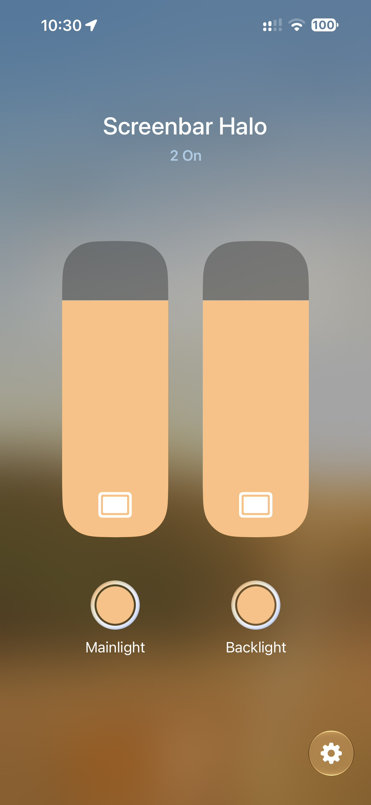
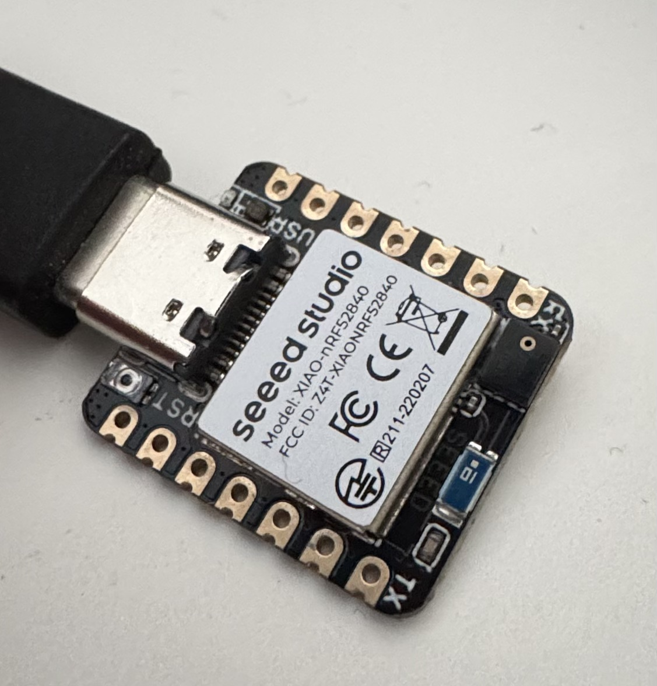

# halo-nrf52840

Control a first-generation BenQ ScreenBar Halo from an nRF52840 (no external RF module required).

<p align="center">&nbsp;&nbsp;</p>

| | `matter/` — Apple Home firmware | root — USB firmware |
|---|---|---|
| What it is | Matter over Thread: the ScreenBar's **front lamp and back lamp as two Color Temperature Lights**, each switchable on its own; brightness and colour temperature are shared by the lamp and stay in sync between the two | USB CDC serial controller, same line protocol as [halo-esp32s3](https://github.com/Junyi-99/halo-esp32s3), `halo_control.py` on the host |
| Needs | XIAO nRF52840 + a Thread border router (HomePod mini, Apple TV 4K, …) | any nRF52840 board on USB |
| SDK | nRF Connect SDK v3.4.1 | Zephyr v4.4.2 |
| Pairing | fixed test code **3497-011-2332**, QR below | n/a |

<p align="center"><br><code>MT:6FCJ142C00KA0648G00</code> · manual code 34970112332</p>

**Status (2026-10-21):** both firmwares verified on the lamp. The Matter firmware is commissioned in
Apple Home through a HomePod mini; on/off, brightness and colour temperature all reach the lamp with
verified ACKs, including bursts of slider moves. Apple shows an "uncertified accessory" warning once
(test vendor ID), then it behaves like any other light. The lamp only ever sends empty ACKs, so
changes made with the original remote are not reflected back.

## Apple Home quick start

1. Build (`matter/build.sh xiao_ble`, needs NCS v3.4.1 under `~/ncs`) or take a release UF2, double-tap
   RST on the XIAO and copy `zephyr.uf2` onto the `XIAO-SENSE` drive.
2. Home app → + → Add Accessory → scan the QR above (or *More options…* → enter 3497-011-2332) →
   *Add Anyway* on the uncertified warning. Commissioning goes over Bluetooth LE, then the XIAO joins
   the border router's Thread network; about a minute.
3. The lamp address is `CONFIG_HALO_LAMP_ADDRESS` in `matter/Kconfig` (default 16224CB1, change it
   for your own lamp).

Every board flashed with this firmware uses the same pairing code (Matter test discriminator 0xF00,
passcode 20202021), so pair one board at a time. Already-paired boards do not need the code again:
sharing with another app goes through the Home app's own pairing mode. Over USB the board also prints
the codes (`matter onboardingcodes ble`) and takes `halo on|off|level|temp` for direct tests and
`halo dfu` to reboot into the UF2 bootloader.

## Build

Zephyr v4.4.2 is installed under `~/zephyrproject` (narrow checkout: zephyr, cmsis, hal_nordic)
with the Zephyr SDK 1.0.1 ARM toolchain in `~/zephyr-sdk-1.0.1` (this machine is aarch64).

```sh
./build.sh xiao_ble                         # Seeed XIAO nRF52840 (UF2, app at 0x27000)
./build.sh promicro_nrf52840/nrf52840/uf2   # Pro Micro / SuperMini / nice!nano clones (UF2, app at 0x26000)
./build.sh nrf52840dongle/nrf52840          # Nordic PCA10059 dongle (Nordic DFU)
./build.sh nrf52840dk/nrf52840              # Nordic DK (J-Link)
./build.sh adafruit_feather_nrf52840        # Feather (UF2 variant)
```

Outputs land in `build/<board>/zephyr/` as `zephyr.uf2` / `zephyr.hex`.

## Flash

Copy the UF2 onto the board's bootloader drive (double-tap RST on the XIAO), or program the hex over SWD with a J-Link; later updates go through the firmware's `DFU` / `halo dfu` command.

## Use

Same protocol as halo-esp32s3, so its tool works unchanged (a copy is in `tools/`):

```sh
pip install pyserial
python tools/halo_control.py --address 16224CB1 --mode back --brightness 50
python tools/halo_control.py --mode front --brightness 100 --led on          # LED in the mode colour, green 1 s on ACK
python tools/halo_control.py --mode front --brightness 100 --rgb 0,0,255     # same with a custom colour
```

Serial, newline terminated, type `HELP` for the full list:

```text
HALO <address_hex> <mode 0-3> <brightness 0-100> <pid 0-3> <gain 0-10> <attempts 1-5>
HALOTEMP <address_hex> <mode 0-3> <temperature 0-100> <pid 0-3> <gain 0-10> <attempts 1-5>
  -> HALODONE <ACK|NO_ACK|RX_ERROR> <attempts> <payload_hex> <crc16> 0 <total_us> <turnaround_us> <ack_us> <ack_crc16>
DIAG            last attempt: RSSI max/when, RSSI during the ACK, bit mismatches, raw bytes
PHY NRF1M|BLE1M modulator (default NRF1M)
```

`gain` maps to TX power: 0..10 → -40 -20 -16 -12 -8 -4 0 +2 +4 +6 +8 dBm. The tool's default 8 is
+4 dBm; the measurements above were at 10 (+8 dBm) with the lamp a few metres away (ACK at -74 dBm).

## Details

How the radio trick works (oversampled 1 Mbit/s GFSK, ACK decoding), the measurements, and the
Matter over Thread design (MPSL timeslots, two endpoints, status LED, shell): [docs/DETAILS.md](docs/DETAILS.md).

## Acknowledgements

- ScreenBar Halo protocol: [Djoko-cli/benq-screenbar-halo-matter](https://github.com/Djoko-cli/benq-screenbar-halo-matter)
- Frame layout and host tool: [halo-esp32s3](https://github.com/Junyi-99/halo-esp32s3)

## License

GPL-3.0, see `LICENSE`.
